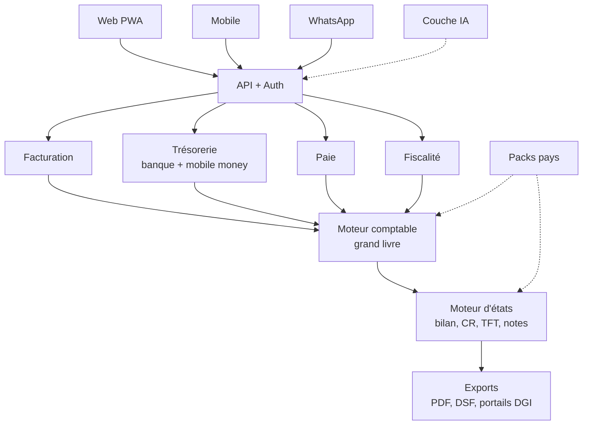
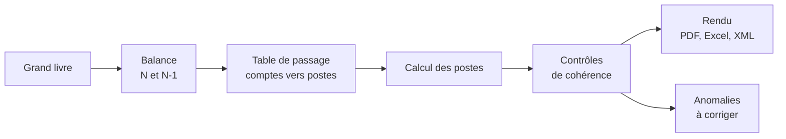
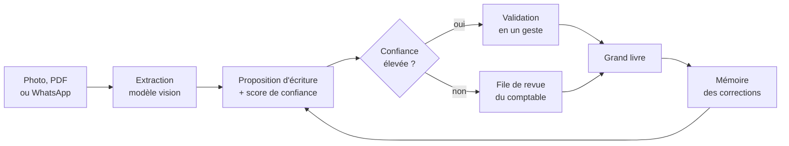
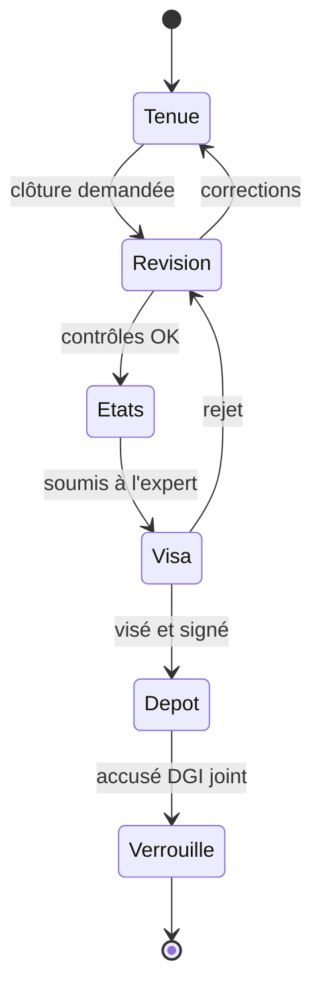

# Architecture technique — Plateforme comptable intelligente OHADA pour PME

Version de référence : document d'architecture du 18 septembre 2026. Ce fichier en reprend le contenu et indique, section par section, ce que le dépôt implémente (« **Dans le dépôt** »).

## 1. Vision et principes

La plateforme est un « QuickBooks OHADA » : la PME facture, encaisse et paie ses salariés, et les états financiers SYSCOHADA sortent automatiquement. Six principes guident toute l'architecture.

1. **Le grand livre est la seule source de vérité.** Facturation, paie, banque et IA ne font que produire des écritures en partie double. Les états financiers se calculent uniquement depuis le grand livre.
2. **Noyau OHADA commun, pays en configuration.** Le plan de comptes, les états et les règles AUDCIF sont identiques dans les 17 pays. Tout ce qui varie (TVA, DSF, paie, format de dépôt) vit dans un « pack pays » versionné, sans code spécifique.
3. **L'IA propose, l'humain valide.** Aucune écriture générée par l'IA n'est comptabilisée sans validation. Chaque proposition porte un score de confiance et sa justification.
4. **Déterministe pour les chiffres, probabiliste pour la saisie.** Les calculs (TVA, paie, états) sont du code testé. L'IA sert à lire des pièces, catégoriser et expliquer, jamais à calculer un état.
5. **Inaltérable et auditable.** Une écriture validée ne se modifie pas, elle se contrepasse. Chaque action est tracée.
6. **Conçu pour le terrain.** Mobile d'abord, tolérant aux coupures réseau, WhatsApp comme canal de saisie, prix en FCFA, paiement par mobile money.

## 2. Vue d'ensemble du système

Un monolithe modulaire derrière une seule API : quatre modules métier alimentent le moteur comptable, qui alimente le moteur d'états. La couche IA et les packs pays sont transverses.



| Couche | Rôle | Ne fait jamais |
| --- | --- | --- |
| Clients | Saisie, consultation, validation | De calcul comptable |
| Modules métier | Factures, encaissements, bulletins, déclarations | D'écriture directe en base : ils passent par le moteur comptable |
| Moteur comptable | Valide et enregistre les écritures, tient les soldes | De logique pays en dur |
| Moteur d'états | Balance → postes → états + contrôles | De modification du grand livre |
| Packs pays | Taux, barèmes, modèles DSF, formats de dépôt | De code exécutable : données et règles déclaratives seulement |
| Couche IA | Lecture de pièces, propositions, assistant | De comptabilisation sans validation humaine |

**Dans le dépôt.** `packages/ledger` (moteur comptable), `packages/statements` (moteur d'états), `packages/rules` + `packages/country-packs` (packs pays), `packages/ai-gateway` (couche IA), `apps/api` (API + auth), `apps/web` (PWA). Les modules métier (facturation, trésorerie, paie, fiscalité) arrivent en phases 2 et 3 et ne pourront écrire qu'à travers `Ledger.createDraft` / `Ledger.post`.

## 3. Stack technique

TypeScript de bout en bout sur PostgreSQL, en réutilisant l'infrastructure ARGILETTE existante (Neon, Cloudflare, Keycloak).

| Brique | Choix | Pourquoi |
| --- | --- | --- |
| Front web | Next.js (React) en PWA, Tailwind | Installable sur mobile, cache hors ligne, FR/EN |
| Mobile | PWA d'abord, puis React Native (Expo) | Évite deux bases de code au MVP |
| API | Node.js + TypeScript (Hono) | Modules clairs, typage partagé avec le front |
| Base de données | PostgreSQL (Neon), Row-Level Security par tenant | ACID, contraintes, isolation multi-tenant dans la base |
| Montants | NUMERIC(20,4) + code devise, jamais de flottants | XOF/XAF sans décimales, mais GNF, CDF, EUR et USD à gérer |
| ORM | SQL natif via `postgres` (+ Drizzle pour les requêtes applicatives) | Les agrégations comptables restent en SQL |
| Files de tâches | BullMQ + Redis | OCR, génération de liasse, imports, relances |
| Fichiers | Cloudflare R2 | Pièces justificatives, PDF, exports DSF |
| Auth | Keycloak (OIDC), MFA, rôles par dossier | Gère cabinets multi-dossiers |
| IA | API Claude (vision + texte) derrière une passerelle interne | Lecture de pièces en français, catégorisation, assistant |
| Recherche sémantique | pgvector dans PostgreSQL | Mémoire des catégorisations passées |
| PDF / Excel | Gabarits HTML → PDF (Playwright), ExcelJS | Modèles officiels, fichiers DSF Excel |
| WhatsApp / SMS | WhatsApp Business API via Twilio ou 360dialog | Canal de saisie et de relance |
| Paiements | Agrégateur mobile money (IAPAY, CinetPay, PayDunya, Flutterwave) | Encaissement de factures et abonnements |
| Observabilité | OpenTelemetry, Sentry, journaux structurés | Traçabilité des calculs et des appels IA |

**Hébergement.** Cloudflare en façade (CDN, WAF), application sur conteneurs, base Neon en région Europe. À vérifier par pays : certaines lois de protection des données (Sénégal, Côte d'Ivoire, Bénin) exigent une déclaration ou autorisation pour l'hébergement hors du territoire.

**Dans le dépôt.** `Money` (`packages/ledger/src/money.ts`) : bigint à 4 décimales, jamais de flottant ; `NUMERIC(20,4)` en base ; les valeurs NUMERIC sont lues en chaînes. L'API est en Hono (routes Next.js + tRPC restent possibles côté front). BullMQ, R2, WhatsApp et paiements sont configurés dans `.env.example` mais branchés en phase 2.

## 4. Modèle de données comptable

Toute la plateforme repose sur deux tables, `journal_entry` et `journal_line`, protégées par des contraintes en base. Chaque ligne porte un `tenant_id` et la Row-Level Security empêche toute fuite entre dossiers.

| Table | Contenu | Règles clés |
| --- | --- | --- |
| `organization` | Cabinet ou groupe qui détient plusieurs dossiers | Porte l'abonnement et les utilisateurs |
| `company` (tenant) | La PME : pays, devise, régime fiscal, système (Normal / SMT), identifiants fiscaux | Référence un pack pays et sa version |
| `fiscal_year`, `period` | Exercices et périodes mensuelles | États : ouvert, clôturé, verrouillé |
| `account` | Plan de comptes : numéro, libellé, classe 1–9, nature, lettrable | Gabarit SYSCOHADA copié à la création ; sous-comptes libres, racines OHADA imposées |
| `journal` | Achats, ventes, banque, caisse, paie, OD, à-nouveaux | Numérotation continue par journal |
| `journal_entry` | En-tête : date, journal, pièce, libellé, statut, source | Brouillon → validé ; validé = immuable |
| `journal_line` | Compte, tiers, débit, crédit, devise, taux, axe analytique, code TVA | Débit ou crédit, jamais les deux ; somme débits = somme crédits |
| `partner` | Clients, fournisseurs, salariés, État | Compte collectif 401 / 411 / 421 rattaché |
| `document` | Pièce justificative (R2), hash SHA-256, données extraites | Liée à l'écriture ; conservation 10 ans (AUDCIF) |
| `reconciliation` | Lettrage et rapprochement bancaire | Lie des `journal_line` entre elles |
| `fixed_asset` | Immobilisations, plan d'amortissement | Génère les dotations ; alimente les notes annexes |
| `audit_log` | Qui, quoi, quand, avant / après | Insertion seule, chaîné par hash |

**Invariants garantis par la base, pas par l'application** (`packages/db/migrations/0001_core.sql`) :

- Équilibre : un trigger de contrainte différé refuse toute écriture dont débits ≠ crédits.
- Inaltérabilité : UPDATE et DELETE interdits sur une écriture validée et ses lignes ; la correction passe par une contrepassation liée (`reverses_entry_id` / `reversed_by_entry_id`, posé une seule fois).
- Période verrouillée : aucune insertion ni validation dans une période clôturée.
- Chaînage : chaque écriture validée stocke le hash de la précédente du journal ; le trigger vérifie la continuité de numérotation et du chaînage, l'application vérifie le contenu (`Ledger.verifyChain`).
- Isolation : RLS forcée sur toutes les tables métier ; le tenant vient de `app.tenant_id`, fixé par l'API depuis le jeton.

**Performance.** `account_balance` (compte × période) est tenue à jour à la validation par un trigger `SECURITY DEFINER` ; le rôle applicatif n'y écrit jamais directement.

**Import.** `planBalanceImport` / `importBalance` reprennent une balance (Excel, Sage 100, Perfecto) avec table de correspondance des comptes, exclusion des comptes de gestion et écriture d'à-nouveaux équilibrée dans le journal AN.

## 5. Moteur d'états financiers

Les états sont décrits en données, pas en code : chaque poste du bilan, du compte de résultat ou du TFT est une formule sur des racines de comptes (`packages/statements/src/templates/syscohada-revise/`).



Le pipeline est une fonction pure (`computeStatements`) : même balance et même version de gabarit donnent toujours les mêmes états.

Définition d'un poste, exemple pour le bilan actif, ligne BI « Clients » :

```json
{ "code": "BI", "label": "Clients", "note": 7, "brut": ["+41:D"], "amort_prov": ["+491:C"] }
```

Le suffixe `:D` ou `:C` ne retient que les soldes débiteurs ou créditeurs, par compte de dernier niveau. Cela gère le client créditeur qui doit passer au passif. Deux suffixes de mouvement (`:DM`, `:CM`) servent au tableau des flux (remboursements, sorties d'immobilisations).

| État | Système Normal | SMT | Source |
| --- | --- | --- | --- |
| Bilan (actif / passif) | Oui | Simplifié | Soldes de clôture, classes 1–5 |
| Compte de résultat | Oui, avec soldes intermédiaires | Recettes / dépenses | Classes 6, 7, 8 |
| Tableau des flux de trésorerie | Oui | Non | Variations N / N-1 + retraitements (CAFG, cessions) |
| Notes annexes (environ 36) | Oui | 2 à 3 notes | Grand livre + modules |
| Liasse fiscale (DSF) | Selon pays | Selon pays | États OHADA + états fiscaux du pack pays |

**Notes annexes : le différenciateur.** Trois familles : notes chiffrées dérivées du grand livre (calculées, rapprochées de leur poste), notes alimentées par un module (immobilisations, paie), notes narratives (brouillon IA à valider, jamais exporté sans relecture).

**Contrôles bloquants** : total actif = total passif ; résultat du bilan = résultat du compte de résultat ; variation de trésorerie du TFT = trésorerie nette N − N-1 ; aucun solde orphelin ; total de chaque note = poste correspondant. **Alertes non bloquantes** : caisse créditrice, compte d'attente 47 non soldé, TVA de sens inhabituel, capitaux propres inférieurs à la moitié du capital (AUSCGIE).

**Tests.** `fixtures/balances/demo-ci/` contient une balance de référence sur deux exercices, produite par le moteur comptable, avec les postes attendus vérifiés à la main ; `pnpm test:statements` la rejoue. Les balances réelles validées par un expert-comptable s'ajoutent au même endroit.

## 6. Couche multi-pays

Un pays = un pack de données versionné, chargé au démarrage et référencé par chaque dossier. Voir `docs/country-packs/README.md`. Chaque règle porte `valid_from` / `valid_to`. Les calculs (TVA, retenues, paie) sont des expressions déclaratives évaluées par l'interpréteur unique `@arcompt/rules` (`tranche(base_imposable, bareme_its)`) ; un pack ne contient jamais de code arbitraire.

Dépôt électronique : aucun portail DGI n'expose d'API publique connue. La cible est de générer le fichier au format exact attendu par le portail, puis de guider le dépôt.

## 7. Modules opérationnels (phases 2–3)

Chaque module émet des événements métier qu'un « posting engine » transforme en écritures selon des modèles paramétrés. Le dirigeant de PME ne voit jamais un débit ou un crédit ; le comptable voit tout.

| Module | Fonctions | Écritures générées |
| --- | --- | --- |
| Facturation | Devis, factures, avoirs, relances, numérotation légale, lien de paiement mobile money | 411 à 701–706 et 443 |
| Achats et dépenses | Factures fournisseurs, notes de frais, capture par photo | 60x–63x et 445 à 401 |
| Trésorerie | Comptes banque, caisse et mobile money, prévision à 13 semaines | 521 / 571 / 5381 |
| Rapprochement | Import de relevés (CSV, PDF, SMS mobile money), appariement automatique | Lettrage 411 / 401, frais bancaires 631 |
| Paie | Salariés, bulletins, cotisations, livre de paie, déclarations sociales | 661 / 664 à 422, 431, 447 |
| Fiscalité | TVA périodique, retenues, acomptes IS, DSF annuelle | Liquidation 443 / 445 à 444 |
| Immobilisations | Fiche, plan d'amortissement, cessions | 681 à 28x ; alimente les notes annexes |
| Stocks (phase 2) | Inventaire simple, variation de stock | 603x / 31x–38x |

Facture électronique certifiée (FNE en Côte d'Ivoire, MECeF au Bénin…) : connecteur de certification par pays prévu dès la conception (`certified_invoice` dans le pack). Banque et mobile money : API des agrégateurs, import de relevés lus par l'IA, puis partenariats bancaires directs. Clôture assistée : liste de contrôle mensuelle et annuelle puis verrouillage de la période.

## 8. Couche IA

L'IA supprime la saisie, pas le comptable.



| Capacité | Fonctionnement | Garde-fou |
| --- | --- | --- |
| Capture de pièces | Extraction en JSON strict (`DocumentExtractionSchema`) | Contrôle HT + TVA = TTC ; doublon par hash et par (tiers, montant, date) |
| Catégorisation | Règles du dossier, puis plus proches voisins (pgvector), puis LLM avec le plan en contexte | Le compte proposé doit exister dans le plan ; sinon rejet |
| Rapprochement bancaire | Appariement par montant, date, libellé ; LLM pour les libellés ambigus | Jamais de lettrage automatique sous un seuil de confiance |
| Assistant | Appels d'outils typés en lecture seule | Pas de SQL libre ; filtré par tenant côté serveur |
| Notes narratives | Brouillon à partir des données | Marqué « à valider », jamais exporté sans relecture |
| Détection d'anomalies | Règles + écarts statistiques | Alerte seulement, aucune correction automatique |

**Passerelle IA interne** (`packages/ai-gateway`) : un seul service encapsule les appels au modèle (minimisation des données, sorties JSON validées par schéma, journal de chaque appel dans `ai_call_log`, quotas par abonnement, fournisseur interchangeable).

## 9. Sécurité, conformité et mode hors ligne

| Domaine | Mesure |
| --- | --- |
| Isolation | RLS PostgreSQL sur `tenant_id` ; le tenant vient du jeton, jamais du client ; `pnpm test:tenancy` vérifie l'absence de fuite |
| Accès | Keycloak OIDC, MFA obligatoire pour cabinets et administrateurs, rôles par dossier (dirigeant, comptable, caissier, auditeur en lecture seule) |
| Chiffrement | TLS partout ; chiffrement au repos ; champs sensibles de paie chiffrés au niveau applicatif |
| Piste d'audit | `audit_log` en insertion seule, chaîné par hash ; export pour commissaire aux comptes |
| Conservation | Pièces et livres conservés 10 ans (AUDCIF) ; export complet du dossier à tout moment |
| Données personnelles | Lois nationales (CI 2013, SN 2008, BJ 2017, TG 2019) : déclarations, DPA, registre des traitements |
| Sauvegardes | Restauration à un instant donné (Neon), copies chiffrées dans une seconde région, test trimestriel |
| IA | Aucune donnée client utilisée pour entraîner un modèle tiers ; minimisation ; journal des appels |

**Hors ligne.** PWA avec cache applicatif ; saisie hors ligne limitée aux brouillons (IndexedDB, UUID côté client) ; synchronisation par file idempotente (`clientId` sur `journal_entry`) ; numérotation légale et validation attribuées uniquement par le serveur ; WhatsApp et SMS en canal de secours.

## 10. Portail cabinets d'expertise comptable

Tableau de bord multi-dossiers, file de revue des propositions IA, collaboration (demande de pièce par WhatsApp, commentaires), marque blanche et tarification cabinet.



L'exercice se verrouille seulement une fois l'accusé de dépôt joint au dossier.

## 11. Feuille de route et risques

| Phase | Durée indicative | Livrable | Client cible |
| --- | --- | --- | --- |
| 0. Fondations | 4–6 semaines | Multi-tenant, auth, plan de comptes OHADA, moteur comptable avec invariants, import de balance | Interne |
| 1. États financiers | 8–10 semaines | Bilan, compte de résultat, TFT, notes annexes, contrôles, PDF officiel, portail cabinets, premier pack pays | Cabinets comptables |
| 2. Gestion quotidienne | 10–12 semaines | Facturation, dépenses, trésorerie, mobile money, rapprochement, capture IA, TVA | PME en direct |
| 3. Paie et fiscalité complète | 10–12 semaines | Paie par pays, déclarations, DSF, facture certifiée, assistant | PME + cabinets |
| 4. Extension | Continu | Nouveaux packs pays, zone CEMAC, stocks, consolidation, SYCEBNL, API publique | Groupes, ONG |

| Risque | Impact | Parade |
| --- | --- | --- |
| Erreur dans un état ou une déclaration | Perte de confiance immédiate des cabinets | Expert-comptable référent par pays, balances de référence en tests, contrôles bloquants |
| Charge de maintenance des packs pays | Lois de finances annuelles | Packs en données versionnées, veille confiée à des cabinets partenaires |
| Pas d'API bancaire ni DGI | Alimentation et dépôt manuels | Lecture IA des relevés, fichiers au format portail, partenariats progressifs |
| Hallucination de l'IA | Écritures fausses | Validation humaine, schémas stricts, comptes contrôlés contre le plan, scores de confiance |
| Adoption par des PME peu formées | Abandon après essai | WhatsApp, interface sans jargon, cabinet comme accompagnateur |
| Périmètre trop large dès le départ | Retard, rien de fini | États financiers d'abord, le reste ensuite |

**À vérifier avant de figer.** Les numéros de comptes, références de postes, taux et noms de portails cités ici et dans le code sont indicatifs. Ils doivent être validés contre le texte officiel du SYSCOHADA révisé et les codes des impôts de chaque pays par l'expert-comptable référent.

## État d'implémentation

| Bloc | Fichiers | Statut |
| --- | --- | --- |
| Monorepo, outillage | `package.json`, `pnpm-workspace.yaml`, `vitest.workspace.ts`, `.github/workflows/ci.yml` | Fait |
| Schéma et invariants | `packages/db/migrations/*.sql`, `packages/db/src/db.test.ts` | Fait, testé contre PostgreSQL |
| Plan de comptes SYSCOHADA | `packages/db/src/chart.ts` | Fait (indicatif) |
| Moteur comptable | `packages/ledger` | Fait : brouillon/validation, contrepassation, chaînage, balance, import |
| Moteur d'états | `packages/statements` | Fait : bilan, CR, TFT, 16 notes, contrôles, fixture de référence |
| Règles et packs pays | `packages/rules`, `packages/country-packs` | Fait : interpréteur, schéma, modèle, pack CI en brouillon |
| Passerelle IA | `packages/ai-gateway` | Fait : schémas, garde-fous, journal, fournisseur Claude ; capture et assistant branchés en phase 2 |
| API | `apps/api` | Fait : auth dev/OIDC, écritures, balance, états, packs |
| Web | `apps/web` | Squelette Next.js + manifeste PWA |
| Portail cabinets, modules métier, WhatsApp, PDF | — | Phases 1 à 3 |
